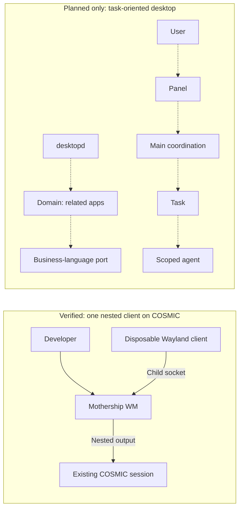

# Mothership WM

Mothership is a Wayland window manager and desktop shell in development. Its
first accepted slice runs inside an existing desktop rather than replacing it.
A developer starts and stops the nested WM; a disposable xdg-shell client
supplies a buffer; the parent compositor owns the outer desktop and displays
the nested output. [Desktop Session](../artifacts/desktop-session.md) owns the
nested lifecycle and readiness rules.

## System map

The planned parts are orientation, not an interface or deployment contract.
The [architecture](../../architecture/README.md) owns technical boundaries.
Domains may group applications and an independent scoped agent. Ports would
describe paths in business terms. A per-task tunnel is a proposal for scoped
access, not unrestricted access or Internet transport. Main and desktopd
coordination is not settled.

## Verification boundary

The [Goal](../goals/boot-nested-wayland-compositor.md) and
[Flow](../flows/boot-nested-wayland-compositor.md) cover the current slice:
a real client's marked pixels were seen in the nested COSMIC output; cleanup
removed the child socket and the same parent remained responsive. Niri,
direct DRM, focus, input routing, camera movement and multi-client behavior
were not validated by this check.
